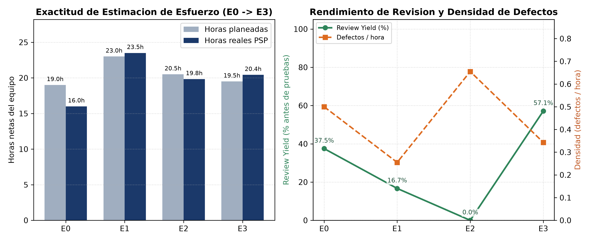

# Retrospectiva Cuantitativa PSP (E0 a E3) — TDL Canastita

**Fuente de datos:** [calidad/tiempo-adolfo.csv](../../calidad/tiempo-adolfo.csv), [calidad/tiempo-andrea.csv](../../calidad/tiempo-andrea.csv), [calidad/defectos-adolfo.csv](../../calidad/defectos-adolfo.csv) y [calidad/defectos-andrea.csv](../../calidad/defectos-andrea.csv)  
**Script reproducible:** [calidad/retrospectiva_psp.py](../../calidad/retrospectiva_psp.py)

---

## 1. Resumen Acumulado E0 -> E3
- **Sesiones registradas:** `40` sesiones netas entre ambos integrantes.
- **Esfuerzo total acumulado:** **`79.75 horas netas`** (**Adolfo `40.50 h`** / **Andrea `39.25 h`**).
- **Total de defectos gestionados y cerrados:** **`34`** (**Adolfo `19`** / **Andrea `15`**), con `480 min` totales de correccion.
- **Exactitud media de estimacion de tiempo:** **`93.52%`**.
- **Review Yield global (atrapados antes de pruebas):** **`23.53%`**.

---

## 2. Evolucion por Etapa: Estimacion, Revision y Densidad

| Etapa | Planeado | Real Adolfo | Real Andrea | Real Equipo | Error Est. (%) | Defectos | Review Yield | Defectos / hora |
| :---: | :---: | :---: | :---: | :---: | :---: | :---: | :---: | :---: |
| **E0** | `19.00 h` | `8.92 h` | `7.08 h` | **`16.00 h`** | `-15.79%` | `8` | **`37.5%`** | `0.500` |
| **E1** | `23.00 h` | `12.25 h` | `11.25 h` | **`23.50 h`** | `+2.17%` | `6` | **`16.7%`** | `0.255` |
| **E2** | `20.50 h` | `10.00 h` | `9.83 h` | **`19.83 h`** | `-3.25%` | `13` | **`0.0%`** | `0.655` |
| **E3** | `19.50 h` | `9.33 h` | `11.08 h` | **`20.42 h`** | `+4.70%` | `7` | **`57.1%`** | `0.343` |

### Hallazgos de Evolucion E0 -> E3
1. **Madurez en estimacion:** En E0/E1 las desviaciones frente al plan nacieron por descubrimientos externos (`robots.txt` de Open-Meteo, codificacion `latin-1` de SNIIM y bloqueos DLL en Windows). Ya en E2 y E3 el error de estimacion se mantuvo dentro de un margen controlado inferior al `±5%`.
2. **Mejora del *Review Yield*:** Mientras en E1 y E2 la mayoria de defectos afloraron hasta `pruebas`, en E3 la revision por pares previa (*Quality Lead*) elevo el *Review Yield* temprano al **`57.1%`** (frente a `16.67%` en E1 y `0.0%` en E2).
3. **Estabilizacion de densidad de defectos:** La tasa paso de `0.500` defectos/hora en E0 (`0.655` en E2 con QA/E2E) a **`0.343`** defectos/hora en E3 incluyendo hallazgos preventivos de revision.

---

## 3. Defectos Inyectados y Eliminados por Fase

| Fase PSP | Inyectados en esta fase | Eliminados en esta fase | Tiempo de correccion invertido |
| :--- | :---: | :---: | :---: |
| `planeacion` | `1` | `0` | `0 min` |
| `diseno` | `5` | `0` | `0 min` |
| `codigo` | `23` | `0` | `0 min` |
| `revision` | `1` | `8` | `105 min` |
| `pruebas` | `4` | `26` | `375 min` |

---

## 4. Distribucion por Taxonomia de Defectos PSP (10 Tipos)

| Tipo de Defecto PSP | Cantidad | Retrabajo total | Promedio por defecto |
| :--- | :---: | :---: | :---: |
| `datos` | `9` | `125 min` | `13.9 min` |
| `entorno` | `9` | `125 min` | `13.9 min` |
| `documentacion` | `4` | `45 min` | `11.2 min` |
| `interfaz` | `3` | `60 min` | `20.0 min` |
| `logica` | `3` | `40 min` | `13.3 min` |
| `funcion` | `2` | `20 min` | `10.0 min` |
| `sintaxis` | `2` | `25 min` | `12.5 min` |
| `sistema` | `2` | `40 min` | `20.0 min` |
