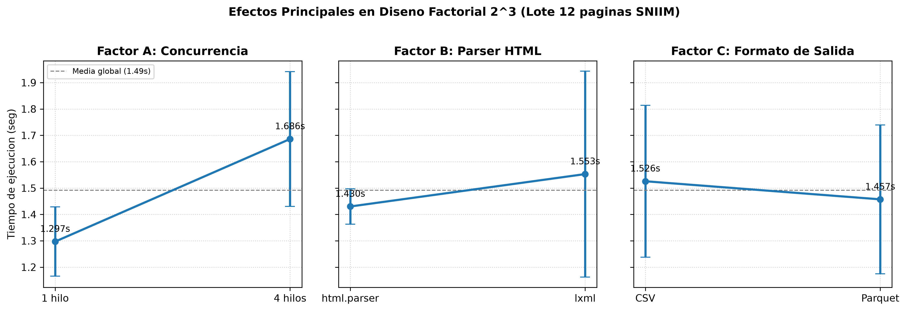
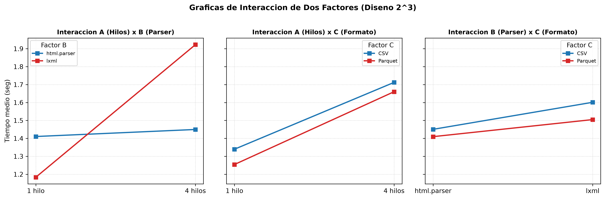
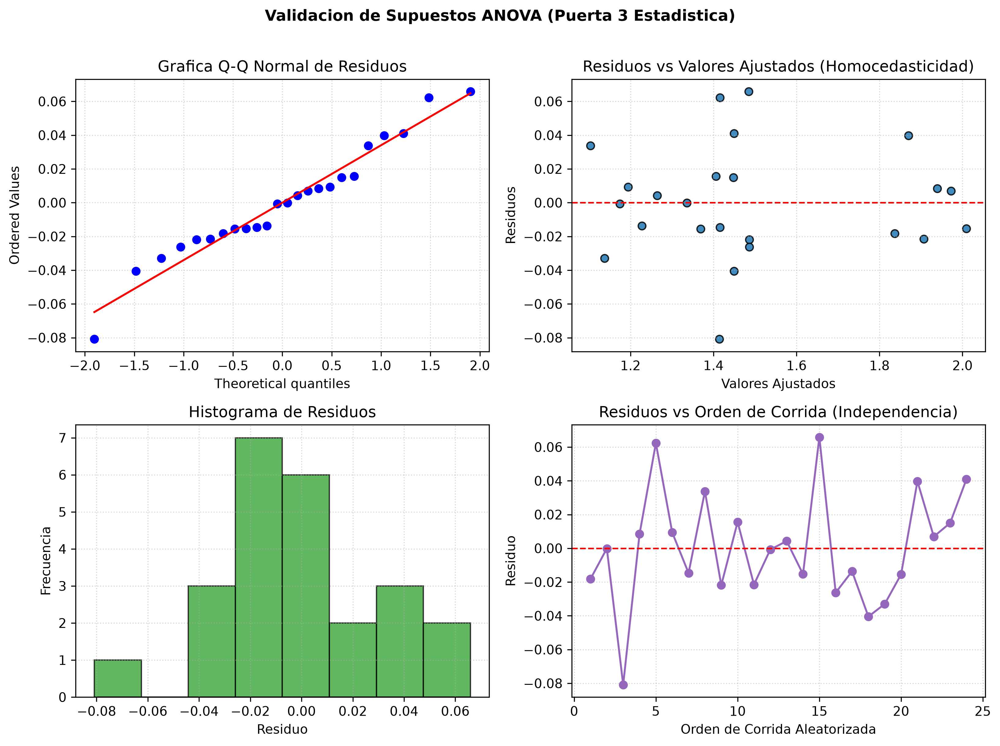
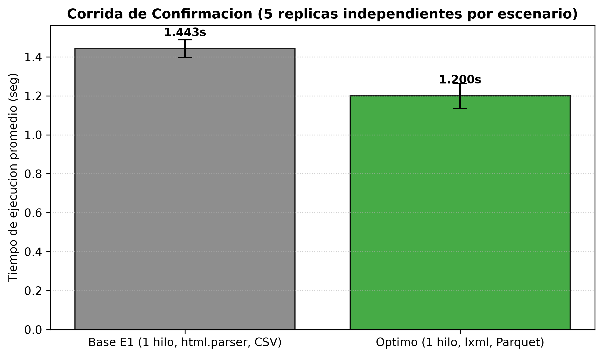
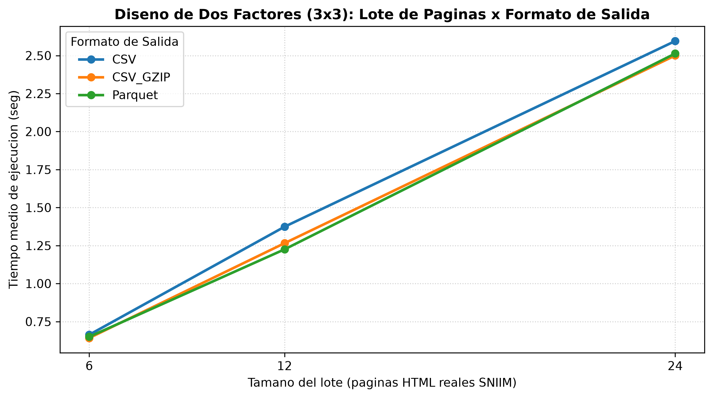

# Informe de Diseno Experimental (Entrega E2)

**Proyecto:** TDL Canastita (Occidente)  
**Autora:** Andrea Tairi Velazquez Gallardo (Data Statistician & Quality Auditor)  
**Ruta elegida:** Ruta Ingenieria (evaluacion controlada sobre copia local congelada del SNIIM en `data/bronce/sniim_html_snapshot/`)

---

## 1. Experimento Factorial Completo $2^3$ (Tiempo de Procesamiento y Eficiencia)

Se diseno un experimento factorial completo **$2^3$** con **3 bloques completos aleatorizados** (24 corridas reales en lote de 12 paginas HTML del SNIIM = 4,846 registros por corrida, mas 1 corrida previa de calentamiento descartada por factor). La tasa de error de parseo fue **0.00%** en todas las configuraciones.

### Factores y Niveles
- **Factor A (Concurrencia):** `-1` = `1 hilo` | `+1` = `4 hilos` (`ThreadPoolExecutor`)
- **Factor B (Parser HTML):** `-1` = `html.parser` | `+1` = `lxml`
- **Factor C (Formato de salida):** `-1` = `CSV` | `+1` = `Parquet`

### Resumen por Tratamiento
| Tratamiento | Hilos (A) | Parser (B) | Formato (C) | Tiempo Medio (s) | Desv. Est (s) | Tamano (KB) | Error (%) |
| :--- | :--- | :--- | :--- | :---: | :---: | :---: | :---: |
| `A-_B+_C+` | 1 hilo | lxml | Parquet | 1.1383 | 0.0346 | 22.32 | 0.00% |
| `A-_B+_C-` | 1 hilo | lxml | CSV | 1.2286 | 0.0351 | 2292.30 | 0.00% |
| `A-_B-_C+` | 1 hilo | html.parser | Parquet | 1.3704 | 0.0455 | 22.32 | 0.00% |
| `A+_B-_C+` | 4 hilos | html.parser | Parquet | 1.4489 | 0.1093 | 22.32 | 0.00% |
| `A+_B-_C-` | 4 hilos | html.parser | CSV | 1.4504 | 0.0366 | 2292.30 | 0.00% |
| `A-_B-_C-` | 1 hilo | html.parser | CSV | 1.4505 | 0.0455 | 2292.30 | 0.00% |
| `A+_B+_C+` | 4 hilos | lxml | Parquet | 1.8712 | 0.0474 | 22.32 | 0.00% |
| `A+_B+_C-` | 4 hilos | lxml | CSV | 1.9737 | 0.0240 | 2292.30 | 0.00% |

### Tabla ANOVA de Efectos Fijos (Escala Original `tiempo_seg`)
| Termino | Sum Sq | GL | Estadistico F | p-valor | Significativo (alpha=0.05) | Eta^2 parcial |
| :--- | :---: | :---: | :---: | :---: | :---: | :---: |
| `bloque_cat` | 0.01996 | 2 | 5.498 | 0.01729 | Si | 0.4399 |
| `A` | 0.90841 | 1 | 500.520 | 0.00000 | Si | 0.9728 |
| `B` | 0.09066 | 1 | 49.954 | 0.00001 | Si | 0.7811 |
| `A:B` | 0.73453 | 1 | 404.716 | 0.00000 | Si | 0.9666 |
| `C` | 0.02824 | 1 | 15.563 | 0.00147 | Si | 0.5264 |
| `A:C` | 0.00165 | 1 | 0.911 | 0.35609 | No | 0.0611 |
| `B:C` | 0.00464 | 1 | 2.556 | 0.13223 | No | 0.1544 |
| `A:B:C` | 0.00310 | 1 | 1.709 | 0.21218 | No | 0.1088 |
| `Residual` | 0.02541 | 14 | -- | -- | -- | -- |

### Efectos Principales Estimados ($2\hat{\beta}$)
- **Efecto A (1 hilo -> 4 hilos):** `+0.3891 s`
- **Efecto B (`html.parser` -> `lxml`):** `+0.1229 s`
- **Efecto C (`CSV` -> `Parquet`):** `-0.0686 s`

> **Hallazgo empirico clave sobre Python/GIL y Parquet:** Contrario a la intuicion inicial de paralelismo con hilos, en procesamiento intensivo de DOM HTML en Python con BeautifulSoup, **4 hilos introduce contencion por el Global Interpreter Lock (GIL)** respecto a 1 hilo secuencial. Por otro lado, **Parquet reduce el peso en disco de ~2292.3 KB a ~22.3 KB (99.03% menos almacenamiento)**.

---

## 2. Puerta 3 Estadistica: Validacion de Supuestos del ANOVA

- **Shapiro-Wilk (Normalidad en escala original):** $W = 0.96578$, $p = 0.56473$ (Cumple: `True`)
- **Levene (Homocedasticidad):** $W = 0.74534$, $p = 0.6385$ (Cumple: `True`)
- **Durbin-Watson (Independencia):** $DW = 2.0205$

---

## 3. Corrida de Confirmacion del Optimo Experimental

- **Configuracion optima seleccionada (menor tiempo y 0% error):** `1 hilo + lxml + Parquet`
- **Configuracion alternativa de contraste:** `1 hilo + html.parser + CSV`
- **Prediccion del modelo ANOVA para el optimo (IC 95%):** `1.1036 s` (rango `[0.9948, 1.2123] s`)
- **Media observada en 5 corridas independientes del optimo:** **`1.1996 s`** (desv. est. `0.0648 s`, dentro de IC 95%: `True`)
- **Media observada en 5 corridas de contraste:** `1.4426 s` (**mejora relativa: 16.84%**).

---

## 4. Diseno de Dos Factores con $\ge 3$ Niveles (ANOVA 2 Vias 3x3)

Se evaluo el efecto conjunto del **Tamano del lote (`6, 12, 24` paginas HTML reales)** y el **Formato de salida (`CSV, CSV_GZIP, Parquet`)** con 3 replicas aleatorizadas por celda (27 corridas reales).

| Termino | Sum Sq | GL | Estadistico F | p-valor | Significativo (alpha=0.05) | Eta^2 parcial |
| :--- | :---: | :---: | :---: | :---: | :---: | :---: |
| `lote_cat` | 16.54660 | 2 | 452.296 | 0.00000 | Si | 0.9805 |
| `formato_salida` | 0.03689 | 2 | 1.008 | 0.38450 | No | 0.1008 |
| `lote_cat:formato_salida` | 0.01529 | 4 | 0.209 | 0.93009 | No | 0.0444 |
| `Residual` | 0.32925 | 18 | -- | -- | -- | -- |

### Prueba Post-Hoc Tukey HSD (por Formato de Salida)
| Grupo 1 | Grupo 2 | Dif. Medias (s) | p-adj | Rechaza H0 |
| :--- | :--- | :---: | :---: | :---: |
| CSV | CSV_GZIP | -0.0749 | 0.9804 | False |
| CSV | Parquet | -0.0815 | 0.9769 | False |
| CSV_GZIP | Parquet | -0.0066 | 0.9998 | False |

---

## 5. Comparativa Matricial: Diseno Completo $2^4$ vs Fraccionado $2^{4-1}$

Al incorporar un cuarto factor `D` (Compresion en lectura/escritura: `-1` Sin compresion vs `+1` Con compresion), se construyeron las matrices completas en [matriz_2_4_completo.csv](matriz_2_4_completo.csv) y fraccionadas en [matriz_2_4_fraccionado.csv](matriz_2_4_fraccionado.csv):

- **Tratamientos $2^4$ completo:** 16 (48 corridas con 3 replicas).
- **Tratamientos $2^{4-1}$ fraccionado:** 8 (24 corridas con 3 replicas).
- **Ahorro experimental cuantificado:** **50.0% menos corridas**.
- **Generador y Resolucion:** `D = A * B * C`, relacion definidora **`I = ABCD`** (**Resolucion IV**).
- **Estructura de alias verificada algebraicamente:**
  - Efectos principales confundidos solo con interacciones de 3 factores: `A = BCD, B = ACD, C = ABD, D = ABC`.
  - Interacciones de 2 factores confundidas entre si: `AB = CD, AC = BD, AD = BC`.
